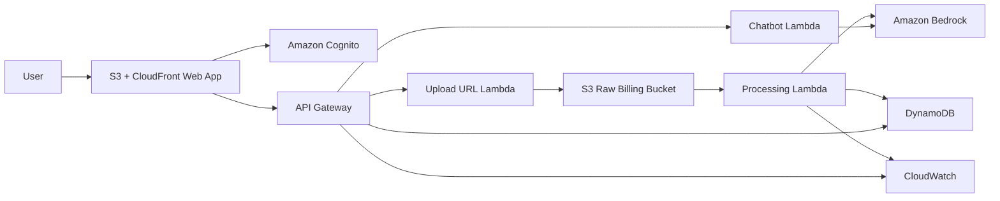
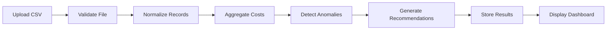

# AI Cloud Cost and Resource Optimization Platform

An AWS serverless platform that converts cloud billing and usage data into understandable cost insights, anomaly alerts, prioritized optimization recommendations, and AI-assisted answers.

## 1. Problem Statement

Small organizations, startups, university research laboratories, and student or developer teams often use public cloud infrastructure without dedicated FinOps specialists. Billing data is fragmented across services and can be difficult to interpret. As a result, teams may continue paying for idle virtual machines, oversized instances, rarely accessed storage, unused GPU capacity, and unnecessary data transfer.

This project addresses that problem by analyzing uploaded cloud billing and usage reports and presenting practical recommendations that can reduce unnecessary spending while preserving application performance and reliability.

## 2. Proposed Solution

The platform allows an authenticated user to upload a simulated or exported billing report. The system processes the report using AWS serverless services, calculates spending summaries, detects inefficient or abnormal resource usage, and generates prioritized recommendations.

Each recommendation includes:

- The resource or service involved
- A description of the detected issue
- A recommended action
- Estimated potential monthly savings
- Performance and reliability trade-offs
- A confidence level and verification step

An AI assistant allows users to ask questions in plain language, such as:

- Which services contributed most to this month's increase?
- Which resources have the highest potential savings?
- How could I reduce my monthly cost by approximately 30%?
- What risks should I consider before stopping this resource?

The platform provides recommendations only. It does not automatically delete, stop, resize, or modify user resources.

## 3. Target Users

- Early-stage startups
- Small and medium-sized organizations
- University research laboratories
- Student and developer teams
- DevOps engineers
- Cloud administrators
- Software developers
- Research lab managers
- Engineering managers and operations staff

## 4. MVP Scope

The first version must demonstrate one complete workflow:

```text
User signs in
    -> uploads a billing CSV
    -> AWS processes the file
    -> dashboard displays cost insights
    -> rules detect inefficient resources
    -> AI explains the findings
    -> chatbot answers questions about the uploaded data
```

### Required MVP functionality

1. Cognito sign-in and authentication.
2. Billing CSV upload using a pre-signed S3 URL.
3. CSV validation and normalization.
4. Cost aggregation by service, project, team, and time period.
5. Detection of idle compute, oversized instances, rarely accessed storage, continuously running GPUs, and cost increases.
6. Dashboard displaying total cost, cost trends, service-level spending, anomalies, and recommendations.
7. DynamoDB storage for processed results.
8. Bedrock-generated explanations grounded in rule-based findings.
9. Chatbot responses based only on the user's processed billing data.
10. CloudWatch logging and basic failure handling.
11. A repeatable demonstration using simulated billing data.

### Features outside the initial MVP

The following may be added later but should not delay the core demonstration:

- Automatic resource deletion, stopping, or resizing
- Multi-cloud support
- Direct production AWS Cost and Usage Report ingestion
- Email notifications through SNS
- Enterprise organization and role management
- Complete Athena-based natural-language analytics
- Automated implementation of recommendations

## 5. AWS Architecture



### Service responsibilities

| AWS service | Responsibility |
|---|---|
| Amazon S3 | Stores uploaded billing files, processed data, and frontend assets |
| Amazon CloudFront | Delivers the frontend over HTTPS |
| Amazon Cognito | Provides user authentication and identity tokens |
| API Gateway | Exposes authenticated REST endpoints |
| AWS Lambda | Performs file processing, aggregation, rules, recommendations, and chatbot requests |
| DynamoDB | Stores normalized records, summaries, recommendations, anomalies, and chat history |
| Amazon Bedrock | Generates plain-language explanations and chatbot answers |
| Amazon Athena | Optional SQL analysis over billing files stored in S3 |
| Amazon CloudWatch | Collects logs, metrics, and debugging information |
| AWS IAM | Applies least-privilege permissions |
| AWS KMS | Encrypts data at rest where configured |
| Amazon SNS | Optional future service for anomaly notifications |

## 6. Processing Workflow



1. The user signs in through Cognito.
2. The frontend requests an upload URL from API Gateway.
3. The upload Lambda returns a short-lived pre-signed S3 URL.
4. The browser uploads the billing file directly to S3.
5. The S3 upload event invokes the processing Lambda.
6. Lambda validates and normalizes the billing records.
7. Lambda aggregates costs and identifies trends.
8. Rule-based checks detect anomalies and optimization opportunities.
9. Bedrock creates explanations using the validated findings.
10. Results are saved in DynamoDB.
11. The frontend retrieves and displays the results.

## 7. Billing CSV Format

The MVP uses a simplified billing format that can later be extended to support AWS Cost and Usage Reports.

```csv
usage_date,service,resource_id,resource_type,project,team,region,usage_hours,usage_amount,monthly_cost,utilization_percent,storage_gb,access_frequency
2026-11-01,EC2,i-001,small-instance,Website,Engineering,us-east-1,720,720,144.00,4,0,low
2026-11-01,EC2,i-002,large-instance,Analytics,Research,us-east-1,720,720,288.00,22,0,medium
2026-11-01,S3,bucket-001,storage,Website,Engineering,us-east-1,0,0,75.00,0,500,rare
2026-11-01,EC2,gpu-001,gpu-instance,ML-Research,Research,us-east-1,720,720,900.00,8,0,low
```

The demonstration dataset should contain multiple services, teams, projects, time periods, normal resources, inefficient resources, and at least one cost increase.

## 8. Recommendation Rules

The rules should produce structured findings before Bedrock is called. This keeps numerical analysis deterministic and prevents the model from inventing billing facts.

### Idle compute

```text
IF resource_type = EC2
AND utilization_percent < 10
AND monthly_cost > 50
THEN recommend stopping the instance when it is not needed or evaluating a smaller instance
```

### Oversized instance

```text
IF utilization_percent < 25
AND monthly_cost > 200
THEN recommend evaluating a smaller instance type
```

### Rarely accessed storage

```text
IF service = S3
AND access_frequency = rare
AND storage_gb > 100
THEN recommend a lifecycle policy or lower-cost storage class
```

### Always-running GPU

```text
IF resource_type contains GPU
AND usage_hours > 650
AND utilization_percent < 20
THEN recommend scheduling or stopping the GPU when idle
```

### Cost anomaly

```text
IF current_period_cost > previous_period_cost * 1.20
THEN flag a significant cost increase
```

Savings must be labeled as estimates and should be verified by a user before action is taken.

## 9. Suggested Data Storage

The MVP can use the following DynamoDB tables:

| Table | Partition key | Sort key | Purpose |
|---|---|---|---|
| `BillingRecords` | `organizationId` | `recordId` | Stores normalized billing records |
| `AnalysisResults` | `organizationId` | `analysisId` | Stores dashboard summaries and trends |
| `Recommendations` | `organizationId` | `recommendationId` | Stores anomalies and optimization recommendations |
| `ChatHistory` | `organizationId` | `timestamp` | Stores chatbot questions and responses |

For a very small prototype, `BillingRecords` and `AnalysisResults` may be combined, but keeping recommendations separate makes the dashboard and testing easier.

## 10. API Endpoints

```text
POST /uploads
GET  /analyses/{analysisId}
POST /chat
GET  /chat/history
GET  /health
```

All endpoints except `/health` should require Cognito authorization. The organization identifier should be derived from the authenticated user rather than trusted from an arbitrary browser request.

## 11. Four Major Workstreams

The project should be divided into four end-to-end workstreams. Each workstream has a clear primary outcome and should be implemented independently before integration.

### Workstream 1: AWS foundation, security, and deployment

**Primary outcome:** A repeatable AWS environment that the other workstreams can use.

Tasks:

1. Create the repository structure and environment configuration.
2. Select one AWS region for development and demonstration.
3. Create the raw upload, processed-data, and frontend S3 buckets.
4. Configure Cognito user authentication.
5. Create API Gateway routes and Cognito authorization.
6. Create Lambda execution roles using least privilege.
7. Configure DynamoDB tables and access permissions.
8. Configure CloudWatch log groups and useful log retention.
9. Configure encryption and KMS where practical.
10. Create infrastructure-as-code templates using SAM, CDK, or Terraform.
11. Document deployment, environment variables, and cleanup commands.
12. Verify that the infrastructure can be deployed from a clean checkout.

**Acceptance criteria:**

- The AWS environment deploys without manual resource creation.
- A test user can authenticate.
- API Gateway can invoke a protected Lambda.
- Lambda can write to the required DynamoDB tables.
- CloudWatch contains logs for test requests.

### Workstream 2: Billing ingestion, analytics, and recommendation engine

**Primary outcome:** A backend pipeline that converts a billing CSV into reliable insights.

Tasks:

1. Define the billing CSV schema.
2. Create valid and intentionally invalid sample files.
3. Implement CSV parsing and required-column validation.
4. Normalize dates, costs, utilization, and resource types.
5. Store normalized records.
6. Calculate total cost and cost by service, team, project, region, and period.
7. Calculate cost trends and top-cost resources.
8. Implement idle compute detection.
9. Implement oversized-instance detection.
10. Implement rarely accessed storage detection.
11. Implement GPU utilization detection.
12. Implement cost anomaly detection.
13. Calculate estimated savings using documented assumptions.
14. Store summaries, anomalies, and recommendations.
15. Add unit tests for parsing, aggregation, rules, and savings calculations.

**Acceptance criteria:**

- A valid CSV produces the expected total cost.
- Costs are correctly grouped by service, team, project, and date.
- The test dataset triggers the expected recommendations.
- Invalid files produce useful errors.
- Results can be retrieved through an API endpoint.

### Workstream 3: Web interface and dashboard

**Primary outcome:** An authenticated web application that makes the analysis easy to understand.

Tasks:

1. Create the frontend project and environment configuration.
2. Build the sign-in and sign-out interface.
3. Connect the frontend to Cognito.
4. Build the billing-file upload screen.
5. Request pre-signed upload URLs from the backend.
6. Display upload and processing status.
7. Build the dashboard summary cards.
8. Add service, project, team, and trend charts.
9. Display anomalies using clear severity labels.
10. Display recommendations with estimated savings and trade-offs.
11. Add loading, empty, and error states.
12. Build the chatbot interface and suggested questions.
13. Deploy the frontend to S3 and CloudFront.
14. Verify the application in a browser using the deployed URL.

**Acceptance criteria:**

- A user can sign in and upload a file.
- The dashboard displays the processed analysis.
- Charts match the backend values.
- Recommendations are understandable to a non-specialist.
- The interface handles processing delays and failures gracefully.

### Workstream 4: AI assistant, integration testing, and final delivery

**Primary outcome:** A grounded AI experience and a reliable final demonstration.

Tasks:

1. Verify Amazon Bedrock model access.
2. Create a prompt for recommendation explanations.
3. Ensure prompts include only validated findings and relevant billing data.
4. Store Bedrock explanations with the original rule-based result.
5. Implement the chatbot Lambda.
6. Retrieve the correct user's processed cost data for each question.
7. Create prompts that prohibit unsupported facts and invented numbers.
8. Store chatbot conversation history.
9. Add a fallback response if Bedrock is unavailable.
10. Test questions about service cost, cost increases, savings, and risk.
11. Run end-to-end tests across upload, processing, dashboard, and chatbot flows.
12. Test authentication and organization data isolation.
13. Capture CloudWatch and dashboard evidence for the final presentation.
14. Complete the README, architecture diagram, demo script, and limitations.
15. Confirm resource cleanup instructions and estimated AWS costs.

**Acceptance criteria:**

- Recommendations receive plain-language explanations.
- Chatbot answers are grounded in uploaded data.
- Bedrock failures do not break the entire dashboard.
- The complete demonstration works from sign-in through chatbot response.
- Documentation allows another person to deploy and test the project.

## 12. Integration Order

Integrate the workstreams in this order:

1. Workstream 1 creates the shared AWS resources and API contracts.
2. Workstream 2 connects file processing to S3 and DynamoDB.
3. Workstream 3 connects the frontend to authentication and backend endpoints.
4. Workstream 4 connects Bedrock, completes testing, and prepares the final demonstration.

The teams should agree on request and response JSON formats before implementation begins. This prevents the frontend and backend from depending on different field names.

## 13. Testing Checklist

### Backend tests

- Valid CSV is accepted.
- Missing required columns are rejected.
- Invalid numbers and dates are rejected.
- Total cost is calculated correctly.
- Service and project aggregation is correct.
- Each recommendation rule triggers correctly.
- Normal resources do not receive false recommendations.
- Estimated savings are calculated correctly.

### Integration tests

- Cognito token is required for protected endpoints.
- Pre-signed upload URL works.
- S3 upload starts the processing workflow.
- Unexpected processing errors are retried by S3, and invalid files are marked FAILED without a retry.
- Results are stored in DynamoDB.
- Dashboard retrieves the correct analysis.
- Chatbot retrieves only the authenticated user's data.
- Bedrock failure produces a controlled fallback.

### User acceptance test

1. Sign in.
2. Upload the demonstration CSV.
3. Wait for processing to finish.
4. Confirm the displayed total matches the expected total.
5. Confirm service and project costs are visible.
6. Confirm at least three recommendations appear.
7. Confirm an anomaly appears for the increased-cost period.
8. Ask the chatbot which resources cost the most.
9. Ask the chatbot how to reduce costs.
10. Confirm the responses use values from the uploaded report.

## 15. Security and Cost Controls

- Keep S3 buckets private.
- Use short-lived pre-signed upload URLs.
- Use Cognito authorization on API routes.
- Derive organization identity from the authenticated token.
- Never place AWS access keys in frontend code.
- Use least-privilege IAM policies.
- Encrypt billing data at rest.
- Use HTTPS through CloudFront.
- Limit file size and chatbot input length.
- Avoid sending complete raw billing reports to Bedrock when summaries are sufficient.
- Cache generated recommendations where possible.
- Configure CloudWatch log retention.
- Avoid unnecessary NAT Gateways and always-running infrastructure.
- Delete test resources after the project demonstration.

## 16. Demonstration Dataset

The primary demonstration should include a predictable scenario such as:

```text
Total monthly cost: $1,407

EC2: $1,332
S3: $75

Highest-cost resources:
1. Low-utilization GPU instance: $900
2. Underutilized large instance: $288
3. Idle small instance: $144
4. Rarely accessed storage: $75
```

Expected recommendations:

1. Schedule the GPU when it is not being used.
2. Evaluate a smaller instance for the underutilized workload.
3. Stop or schedule the idle instance.
4. Apply an S3 lifecycle policy or lower-cost storage class.

Estimated savings should be shown as potential savings and should not be presented as guaranteed savings.

## 17. Expected Final Deliverables

- Deployed web application
- Source code repository
- Infrastructure-as-code templates
- Sample valid billing CSV
- Sample invalid billing CSV
- Architecture diagram
- API documentation
- Unit and integration test results
- CloudWatch evidence
- Demonstration script or recording
- README deployment instructions
- Security and cost-control explanation
- Limitations and future-work section

## 18. Limitations and Future Improvements

The MVP analyzes uploaded billing data and does not directly change cloud resources. Savings are estimates based on the fields available in the uploaded report. A production version should support native AWS Cost and Usage Reports, real utilization metrics from CloudWatch, multiple cloud providers, automated budget alerts, approval workflows, and optional human-approved resource actions.

Future versions could also use Athena for large-scale billing queries, SNS for notifications, a retrieval-augmented knowledge base for cloud pricing guidance, and historical analyses across multiple uploaded reports.

## Deployment

Prerequisites:

- AWS CLI v2, with credentials that can create the resources in this project (`aws sts get-caller-identity` should succeed)
- Node.js 18 or newer, and npm
- One-time Amazon Bedrock access to Claude Haiku 4.5 in `us-west-2`. Anthropic asks for a short use-case form in the Bedrock console. Until that is enabled, explanations and chat still work, using fallback text.

From the repository root:

```bash
./deploy.sh
```

The script is safe to re-run; it updates the stacks in place. Expect about 10-20 minutes. It does the following:

1. Deploys the frontend bucket and CloudFront distribution (`cloud-cost-optimizer-frontend`) and reads the site URL.
2. Creates a private artifact bucket, then packages and deploys the backend (`cloud-cost-optimizer-backend`): Cognito, the upload bucket, four DynamoDB tables, the HTTP API, and the upload, processing, and chatbot Lambdas.
3. Writes `frontend/.env` from the backend outputs (`VITE_AWS_REGION`, `VITE_COGNITO_USER_POOL_ID`, `VITE_COGNITO_CLIENT_ID`, `VITE_API_BASE_URL`), then builds the site and uploads it.

At the end it prints the site URL and the API URL. A new CloudFront distribution can take another 5-10 minutes before that site URL loads.

To run the frontend on your computer against the deployed backend, after `./deploy.sh` has written `frontend/.env`:

```bash
cd frontend
npm ci
npm run dev -- --port 5174
```

The API and the upload bucket allow `http://localhost:5174`. Sign up on that page, then upload a CSV.

Optional environment variables: `PROJECT_NAME` (default `cloud-cost-optimizer`), `AWS_REGION` (default `us-west-2`), `BACKEND_STACK`, and `FRONTEND_STACK`.

## 19. Cleanup

From the repository root, tear the deployment down with:

```bash
./destroy.sh
```

The script asks you to type the project name before it deletes anything. Pass `--yes` to skip that prompt. It empties the upload bucket, deletes the backend stack, empties the frontend bucket, and deletes the frontend stack. Pass `--all` to also delete the artifact bucket. Stacks and buckets that are already gone are skipped.

After testing, remove or disable resources that generate charges, including:

- S3 objects and buckets
- CloudFront distributions
- API Gateway stages
- Lambda functions
- DynamoDB tables
- Cognito pools
- CloudWatch log groups
- KMS keys, after confirming that no retained data depends on them

Use the infrastructure-as-code deletion command where possible so that resources are removed consistently. Verify the AWS billing console after cleanup.

## 20. Definition of Done

The project is complete when:

- A new user can authenticate.
- The user can upload a valid billing CSV.
- The file is processed automatically.
- The dashboard displays correct cost data.
- The system detects inefficient resources and anomalies.
- Recommendations include estimated savings and trade-offs.
- Bedrock explains findings in plain language.
- The chatbot answers questions using the uploaded data.
- Invalid input and service failures are handled clearly.
- Tests and evidence are completed.
- The project can be deployed and cleaned up using documented instructions.
